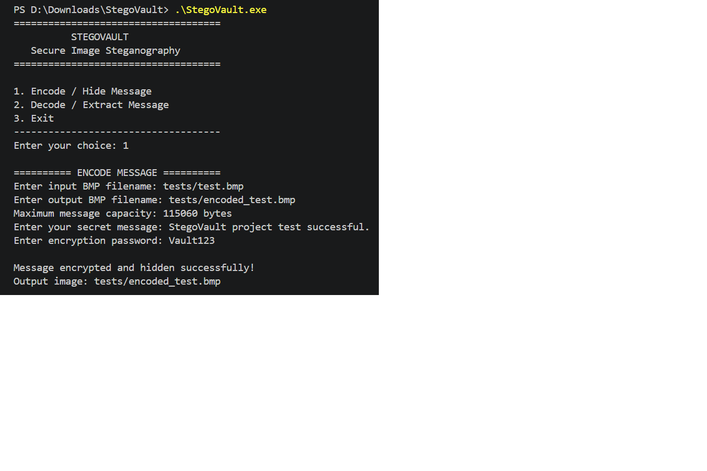
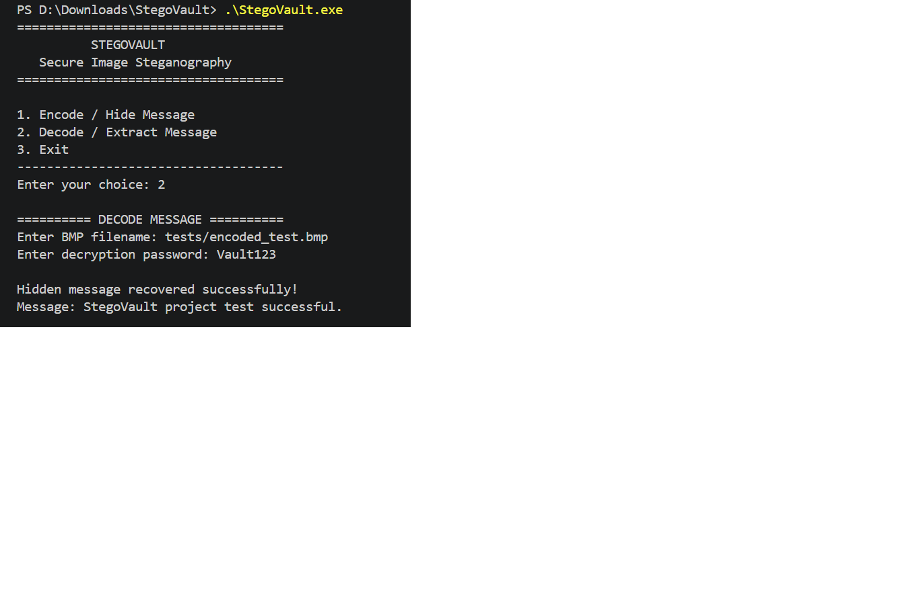
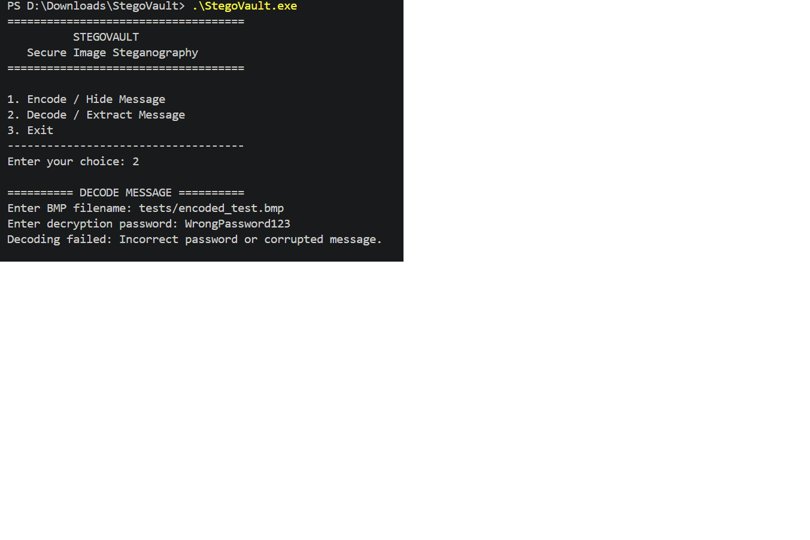
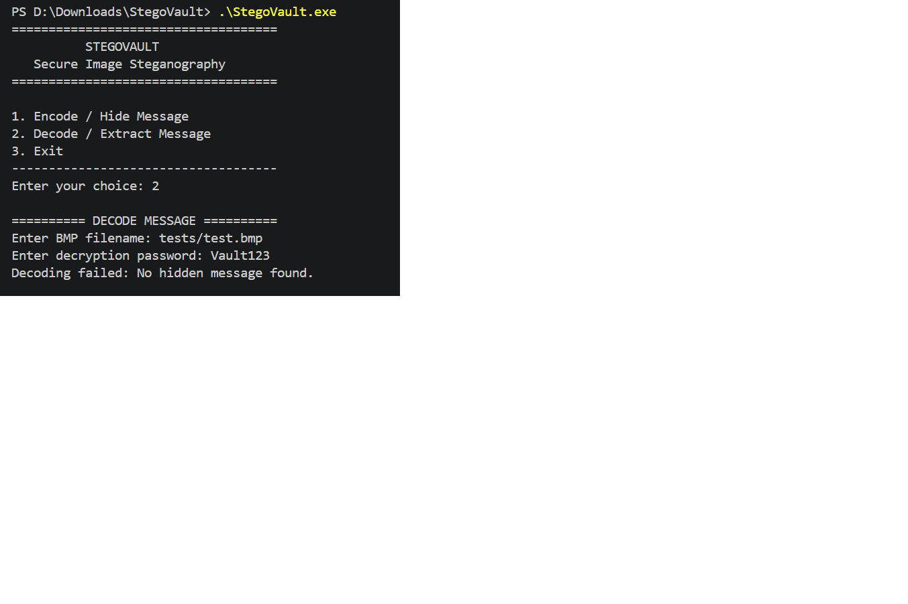
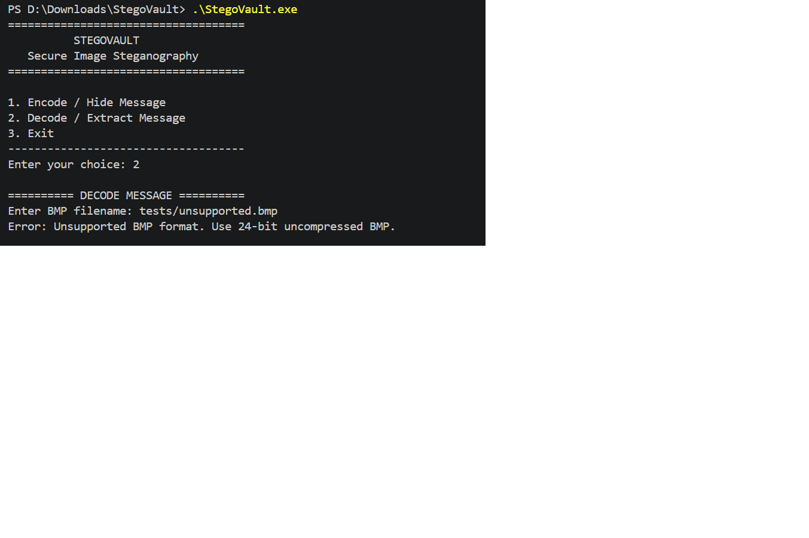
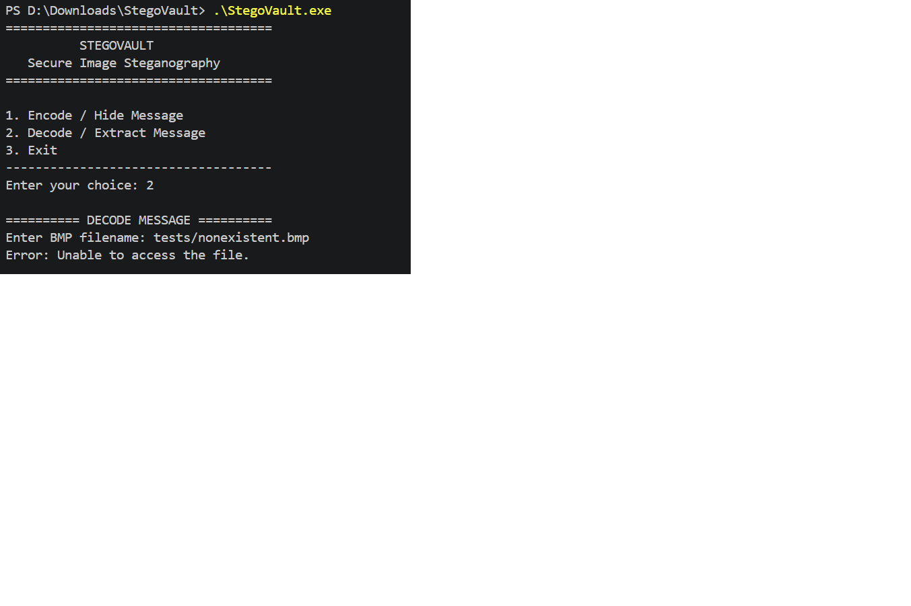
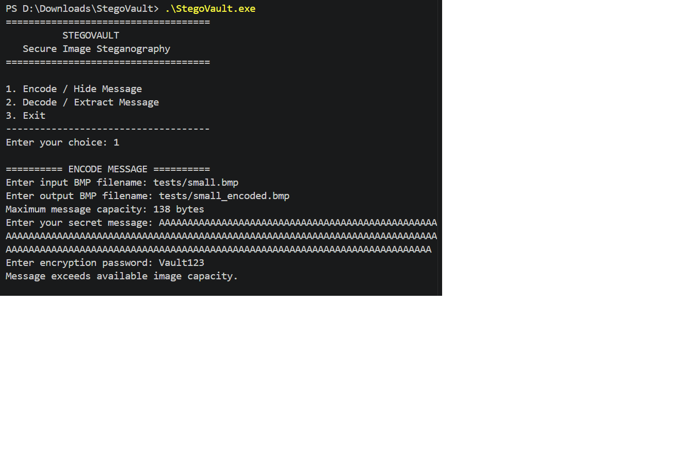
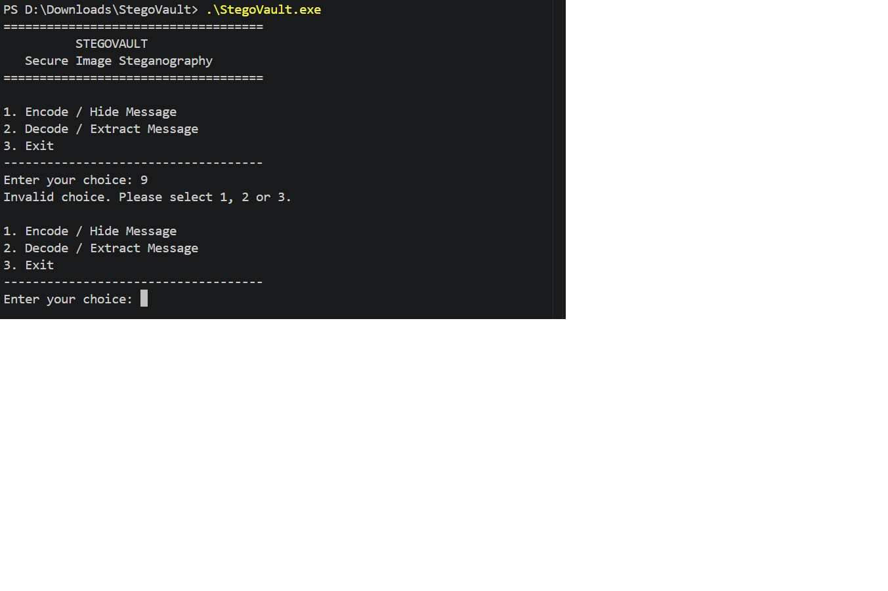
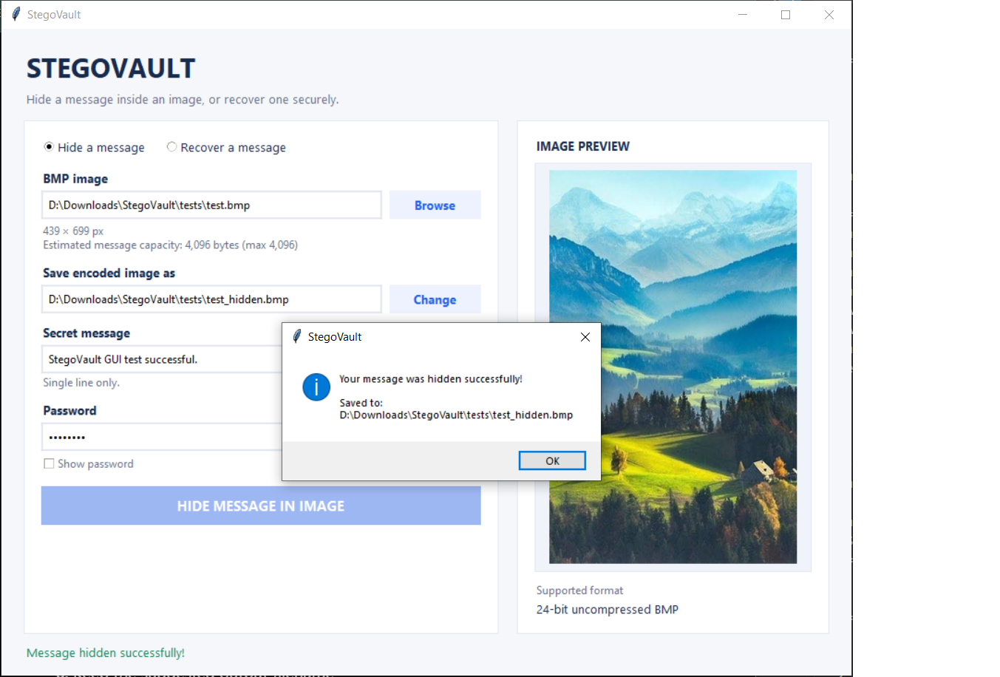
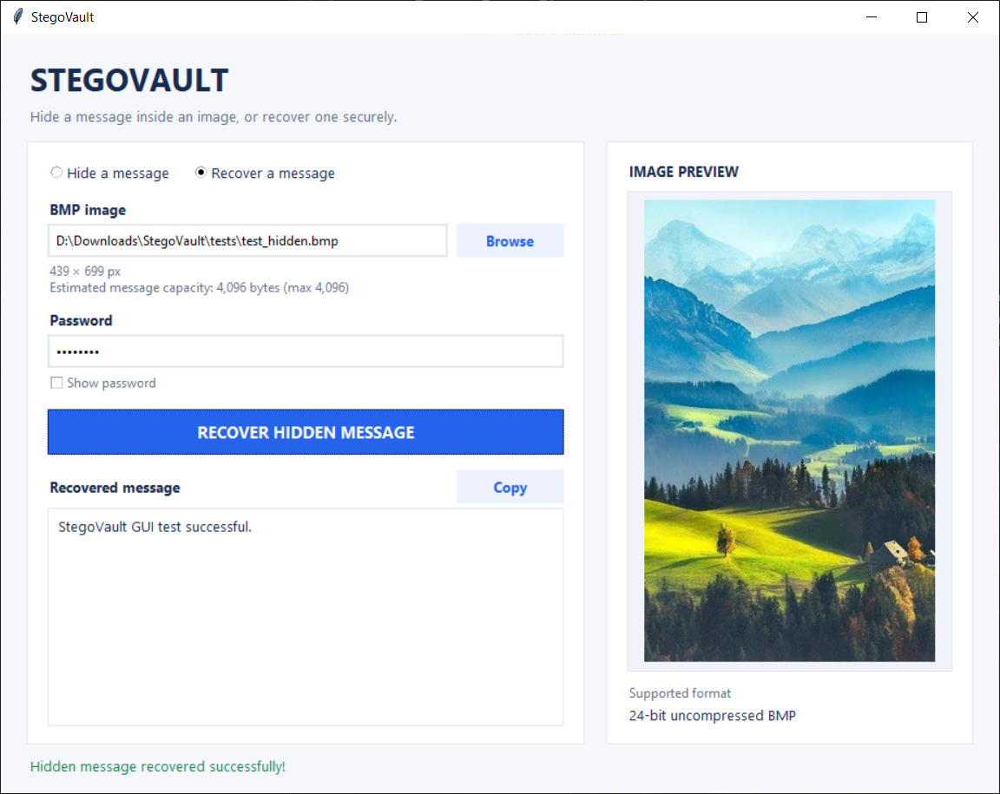

# StegoVault

## A. Project Introduction

StegoVault is a C programming project that allows users to hide secret messages inside BMP images and recover them later using a password.

The main idea behind this project is steganography, which means hiding information inside another file so that the information is not immediately visible. StegoVault uses the Least Significant Bit (LSB) technique to hide messages in image pixels.

Before hiding a message, the program encrypts it using XOR encryption and a password provided by the user. When recovering the message, the same password is required. A checksum is also used to help identify an incorrect password or a corrupted message.

The project has two interfaces:

- **Command-Line Interface (CLI):** The main application, written in C and divided into separate source and header files.
- **Graphical User Interface (GUI):** An additional interface made using Python and Tkinter. It makes the application easier to use by providing buttons, image previews, input fields and message recovery options.

The GUI does not perform the encryption or steganography itself. It communicates with the C executable, which handles the actual operations.

### Technologies Used

- C programming language (C11)
- Python
- Tkinter
- Pillow (PIL)
- GCC compiler
- Visual Studio Code

### Supported Images

StegoVault currently supports:
- BMP image files
- 24-bit colour depth
- Uncompressed images

---

## B. Features & Test Cases

### Main Features

The following features are included in StegoVault:

1. Hide a secret message inside a BMP image.
2. Recover a previously hidden message using the correct password.
3. Encrypt messages using password-based XOR encryption.
4. Use checksum verification to detect incorrect passwords or corrupted messages.
5. Check whether an image format is supported.
6. Check whether the message fits inside the selected image.
7. Handle invalid inputs and file-related errors.
8. Preview images before performing an operation through the GUI.
9. Show recovered messages and allow users to copy them.
10. Display the message length and provide an option to show or hide the password.

### CLI Test Cases

#### Test Case 1: Successful Message Encoding

**Description:** This test checks whether the program can successfully hide a message inside a supported BMP image.

**Inputs:**
- Menu choice: 1
- Input image: `tests/test.bmp`
- Output image: `tests/encoded_test.bmp`
- Secret message: `StegoVault project test successful.`
- Password: `Vault123`

**Expected Output:** The program confirms that the message has been successfully encrypted and hidden. A new encoded image is created.

**Screenshot:**



#### Test Case 2: Successful Message Decoding

**Description:** This test checks whether the program can recover the message hidden in the encoded image when the correct password is entered.

**Inputs:**
- Menu choice: 2
- Input image: `tests/encoded_test.bmp`
- Password: `Vault123`

**Expected Output:** The program successfully recovers and displays the original message:

`StegoVault project test successful.`

**Screenshot:**



#### Test Case 3: Incorrect Password

**Description:** This test checks how the program responds when a user enters the wrong password while trying to recover a message.

**Inputs:**
- Menu choice: 2
- Input image: `tests/encoded_test.bmp`
- Password: `WrongPassword123`

**Expected Output:** The program displays an error message indicating that the password is incorrect or the message may be corrupted.

**Screenshot:**



#### Test Case 4: No Hidden Message Found

**Description:** This test checks what happens when a user tries to recover a message from an image that does not contain one.

**Inputs:**
- Menu choice: 2
- Input image: `tests/test.bmp`
- Password: `Vault123`

**Expected Output:** The program displays `No hidden message found.`

**Screenshot:**



#### Test Case 5: Unsupported BMP Format

**Description:** This test checks whether the program rejects an image with an unsupported format. StegoVault only supports 24-bit uncompressed BMP images.

**Inputs:**
- Menu choice: 2
- Input image: `tests/unsupported.bmp`
- Password: `Vault123`
- Image bit depth: 32-bit

**Expected Output:** The program displays an unsupported BMP format error.

**Screenshot:**



#### Test Case 6: File Not Found

**Description:** This test checks how the program handles a file that cannot be found at the specified location.

**Inputs:**
- Menu choice: 2
- Input filename: `tests/nonexistent.bmp`
- Password: `Vault123`

**Expected Output:** The program displays `Unable to access the file.`

**Screenshot:**



#### Test Case 7: Message Exceeds Image Capacity

**Description:** This test checks whether the program prevents users from hiding a message that is too large for the selected image.

**Inputs:**
- Menu choice: 1
- Input image: `tests/small.bmp`
- Output image: `tests/small_encoded.bmp`
- Secret message: 200 characters
- Password: `Vault123`

**Expected Output:** The program displays an error indicating that the message is too large for the selected image.

**Screenshot:**



#### Test Case 8: Invalid Menu Choice

**Description:** This test checks how the program responds when the user enters a menu option that is not available.

**Inputs:**
- Menu choice: 9

**Expected Output:** The program displays an invalid menu choice message and returns to the menu.

**Screenshot:**



### GUI Test Cases

#### GUI Test Case 1: Hiding a Message

**Description:** This test checks whether a user can hide a message through the graphical interface by selecting an image, entering a message and providing a password.

**Inputs:**
- Mode: Hide a message
- Input image: `tests/test.bmp`
- Secret message: `StegoVault GUI test successful.`
- Password: `Vault123`

**Expected Output:** A success notification appears, and the encoded image is saved at the selected location.

**Screenshot:**



#### GUI Test Case 2: Recovering a Message

**Description:** This test checks whether a user can recover a hidden message through the graphical interface.

**Inputs:**
- Mode: Recover a message
- Input image: Encoded BMP image
- Password: `Vault123`

**Expected Output:** The recovered message is displayed in the GUI.

**Screenshot:**



---

## C. Instructions to Clone and Execute

### Requirements

Before running the project, make sure the following are installed:

- GCC compiler
- Python 3
- Git
- Pillow library

### 1. Clone the Repository

Open a terminal and run:

```bash
git clone https://github.com/YOUR_USERNAME/stegovault.git
```

Replace `YOUR_USERNAME` with your GitHub username.

Move into the project folder:

```bash
cd stegovault
```

### 2. Compile the C Program

Compile the C source files using GCC:

```bash
gcc -std=c11 -Wall -Wextra -o StegoVault.exe main.c bmp.c crypto.c stego.c
```

### 3. Run the CLI Application

In Windows PowerShell, run:

```powershell
.\StegoVault.exe
```

The program will display a menu where users can choose to hide a message, recover a message or exit.

### 4. Install the GUI Requirement

The graphical interface uses Pillow for image previews. Install it with:

```bash
py -m pip install Pillow
```

### 5. Run the GUI

Make sure the C application has been compiled and that `StegoVault.exe` is in the same folder as `gui.py`.

Run:

```bash
py gui.py
```

The StegoVault graphical interface will open. Users can select an image, enter a message and password, and choose whether to hide or recover a message.

---

**Note:** This project was developed for educational purposes. The XOR encryption used here demonstrates a basic encryption technique and is not intended to provide strong security for sensitive information.